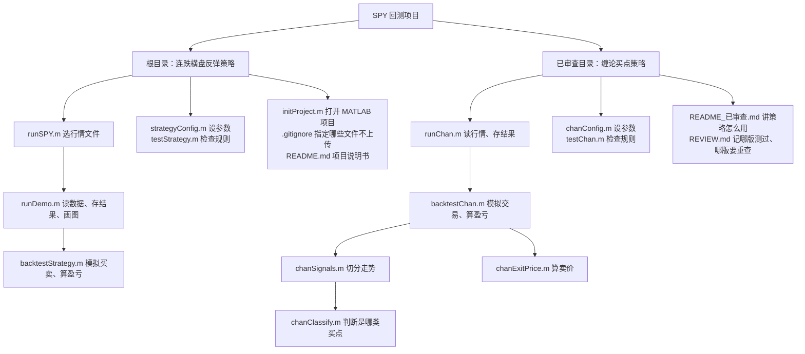
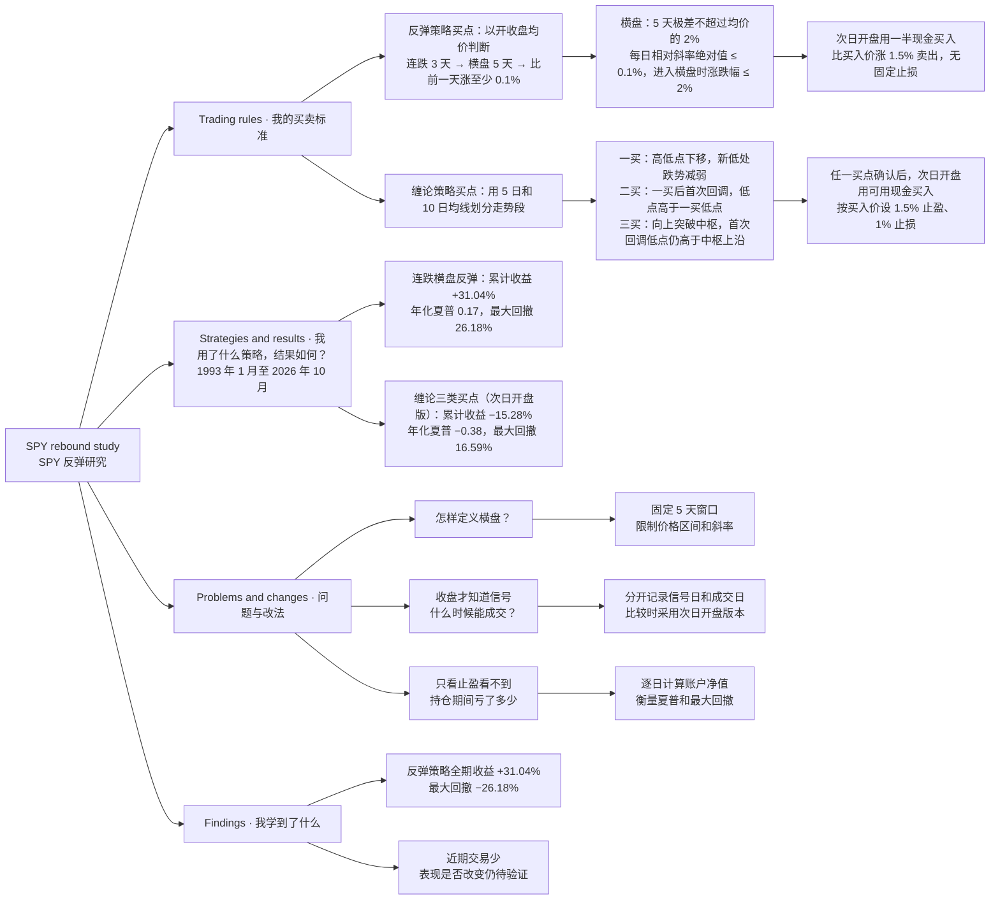
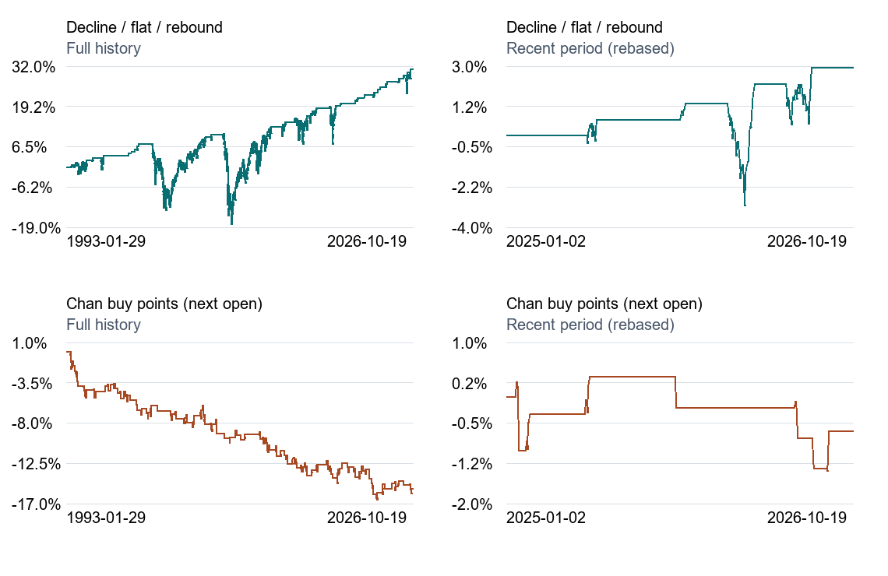

# SPY rebound strategy | SPY 反弹策略

## 这个文件有什么用？

这是给看项目的人读的说明书：策略怎么买卖、回测结果怎样、怎样自己运行。删掉后 MATLAB 仍能回测，但 GitHub 首页会少了这些说明和图表。


## 文件地图



## Project map | 项目思维导图



**CV summary (English).** Built a MATLAB backtest for two SPY trading strategies using daily prices from 1993 to 2026. Defined entry and exit rules, separated signal dates from execution dates, and compared returns, Sharpe ratios and drawdowns across periods.

**中文简历表述。** 用 MATLAB 对两套 SPY 交易策略进行回测，覆盖 1993 至 2026 年的日线数据。将买卖条件写成明确规则，区分信号日与成交日，并分时段比较收益率、夏普比率和最大回撤。

## English

I built a daily backtest in MATLAB to answer a simple question: after SPY falls for several days and trades in a narrow range, does a small rebound give a useful entry signal?

I used the average of each day's open and close to measure the pattern. I looked for three daily declines, five days of sideways movement and then a rise of at least 0.1%. The strategy enters at the next open with half the available cash and sells when the price reaches 1.5% above the entry fill. It has no stop-loss. The backtest tracks cash, shares, fees and slippage, and values the account at each day's close.

I also compared it with an earlier version of a moving-average strategy based on three Chan-style buy points. That version uses the available cash to enter at the next open and sets a 1.5% profit target and a 1% stop. Position size and exit rules differ, so the comparison measures the two complete strategies.

**Problems I worked through**

- “Three down days, then sideways” was too vague to test. I defined the windows, the maximum price range and slope, and the minimum rebound before writing the entry rule.
- The signal needs the closing price. I separated the signal date from the next opening trade and checked that changing future prices did not change earlier signals. A later Chan implementation fills at the signal-day close. I used the saved next-open version for the comparison below.
- A profitable exit can hide a long period of losses while a position is open. I measured daily account value and drawdown, including open positions and idle cash. The rebound strategy gained 31.04% over the full period but fell 26.18% from its peak at one point.

## 中文

我用 MATLAB 回测了一个具体想法：SPY 连跌几天，随后价格走平，第一次小幅反弹是否值得买入？

我用每天开盘价和收盘价的平均值判断走势。连续下跌 3 天、横盘 5 天之后，如果一天上涨至少 0.1%，就在次日开盘用一半可用现金买入。价格比实际买入价上涨 1.5% 时卖出，没有止损。程序记录现金、股数、手续费和滑点，每天收盘计算账户净值。

我还比较了一个较早的缠论买点版本。它根据均线识别三类买点，次日开盘用可用现金建仓，设 1.5% 止盈和 1% 止损。两个版本的仓位和退出规则都不同，因此表里的差异反映的是整套策略的表现。

**遇到的问题和处理方法**

- “连跌后横盘”靠看图容易有不同解释。我把天数、横盘区间、斜率和反弹幅度写成明确条件，让同一组数据产生一致的信号。
- 当天收盘后才能确认信号。我分开记录信号日和成交日，并检查修改未来价格是否会影响已有信号。缠论代码后来改为信号日收盘成交，仍有时序问题；下图采用保存的次日开盘版本。
- 单看已卖出的交易，容易忽略等待止盈期间的亏损。我把未平仓头寸和闲置现金都计入每日净值。反弹策略全期累计赚了 31.04%，但账户从高点最多跌过 26.18%。

## Backtest results | 回测结果



Top row: rebound strategy. Bottom row: Chan buy points. Left: full history. Right: returns since January 2025, starting from zero. Vertical scales differ.  
上排为反弹策略，下排为缠论买点；左侧为全期，右侧为近期重新归零后的累计收益。各图纵轴刻度不同。

| Strategy / 策略 | Period / 时段 | Total return / 累计收益 | Annualized Sharpe / 年化夏普 | Max drawdown / 最大回撤 |
|---|---|---:|---:|---:|
| Rebound / 反弹 | Full / 全期 | +31.04% | 0.17 | −26.18% |
| Rebound / 反弹 | 1993–2024 | +27.30% | 0.16 | −26.18% |
| Rebound / 反弹 | 2025–2026 | +2.94% | 0.54 | −4.42% |
| Chan / 缠论 | Full / 全期 | −15.28% | −0.38 | −16.59% |
| Chan / 缠论 | 1993–2024 | −14.72% | −0.39 | −16.59% |
| Chan / 缠论 | 2025–2026 | −0.65% | −0.26 | −1.76% |

Dates: 1993-01-29 to 2026-10-19. The recent period begins 2025-01-02 and carries forward the account and signal history. Sharpe uses daily account returns including idle days, a zero risk-free rate and 252 trading days per year. Drawdown is measured from the running peak within each period. The short recent window gives limited evidence about changes in performance.

全期为 1993-01-29 至 2026-10-19，近期从 2025-01-02 开始，沿用此前的账户状态和信号历史。夏普按每日账户收益计算，包含空仓日，无风险利率取零，按每年 252 个交易日年化。最大回撤从各区间内的高点计算。近期样本较短，难以据此判断策略表现是否发生变化。

## Implementation notes | 原项目使用与实现说明


这是单只股票的研究/回测项目，不连接券商、不下单。默认例子为人为构造的模拟价格，不能用来判断盈利能力。

## 使用

在 MATLAB 中打开此目录或项目，运行 `runDemo`。读取自己的数据：

```matlab
runDemo('D:\你的数据目录\stock.csv')
```

CSV 必须包含 `Date,Open,High,Close`，日期格式 YYYY-MM-DD，按日期升序且不能重复。每行一个真实交易日。不要填充周末。价格需为正值、无缺失值。

## 精确定义（参数在 strategyConfig.m）

1. 连跌：横盘之前的 3 个连续信号价格收益率均小于 0，需要 4 个信号价格。
2. 横盘：随后 5 个信号价格的极差/均价不超过 2%，线性拟合斜率/均价的绝对值不超过每日 0.1%。进入横盘的首日价格相对前日变化也不得超过 2%。
3. 反弹：横盘后的下一天，信号价格相对前日上涨至少 0.1%。它不是相对最低价上涨 0.1%。
4. 当天收盘才产生信号，下一交易日开盘按开盘价加 0.05% 滑点成交。使用当时现金的 50%，包含 0.05% 手续费，整股向下取整。
5. 买入后设止盈限价为实际买入价 × 1.015，触及即全部卖出。这是股价毛收益 1.5%，扣除手续费后净收益略低。日线 High 用于判断限价是否触及；假设立即挂单且足量成交，允许开盘买入当日止盈。已有仓位遇跳空高开时按开盘价扣滑点成交，但不低于限价。卖出后等待卖出日之后的新信号，不加仓。最后一天仅有买入信号不会成交。

这些定义是实现第一版所作的假设，不是用户已指定的唯一解释。标的固定为用户选择的 SPY ETF。止损、观察有效期和多股票资金分配尚未实现。

## 输出

results/daily.csv：每日信号、持仓、现金、资产和回撤。
results/trades.csv：信号日、成交日、成交价、股数、手续费。
results/summary.csv：总收益、最大回撤、买入持有收益、买入次数、期末持仓。
results/backtest.png：价格、资金曲线、回撤图。

买入持有基准在第一天开盘投入全部资金，并使用同样的费用及滑点模型。策略仅投入约一半资金，因此两者的风险暴露并不相同。现金利息默认零。

## 数据约定和限制

Open 和 Close 必须使用一致的价格口径。直接使用未复权价格会受拆股影响，且本程序未单独记分红、拆股、税费。若使用一致复权的 OHLC，可做简化研究，但对应股数/成交价并非真实历史成交记录。不能将复权 Close 与未复权 Open 混用。

默认每次成交按比例收费，不含最低佣金；假设次日开盘可按该价格加滑点成交，不处理停牌、成交量约束、涨跌停。严肃验证需补齐这些细节，用独立样本检验，不应只优化到历史最好结果。

## 验证

运行 `testStrategy`，检查信号触发、次日成交、费用预算、未来价格变化不影响已有信号、末日不成交和无信号情形。

项目代码可放 GitHub；默认忽略 results 和 data 下的 CSV。

## SPY 数据与运行

运行 `runSPY` 选择真实 SPY 日线 CSV；列为 Date,Open,High,Close，OHLC 必须保持同一复权口径。程序不会自动下载行情，也不能仅凭 CSV 文件名验证标的，请确保提供 SPY 数据。`runDemo` 仍是模拟数据，不能当作 SPY 历史收益。图上圆圈为信号、绿色上三角为买入、红色下三角为卖出。

## 从 GitHub 克隆后
在 MATLAB 中进入仓库目录，运行 initProject 重建并打开 MATLAB 项目，再运行 testStrategy、runDemo。MATLAB 自动项目元数据不上传；源代码可独立运行。


## 信号价格更新

所有买入条件统一使用 SignalPrice = (Open + Close) / 2；不是 Open + Close/2，也不是全天成交均价或 VWAP。SignalReturn 为此价格的日变化。日收盘后才能确定信号，仍于次日开盘成交。持仓日终估值仍用 Close，止盈仍按真实模拟买入价乘 1.015，用 High 判断是否触及。首图改画 SignalPrice；买卖点仍标实际成交价，可能不在曲线上。
