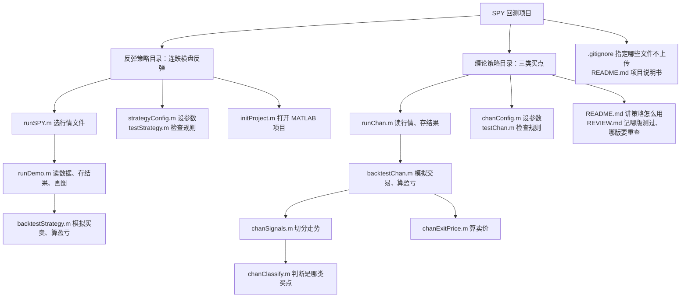
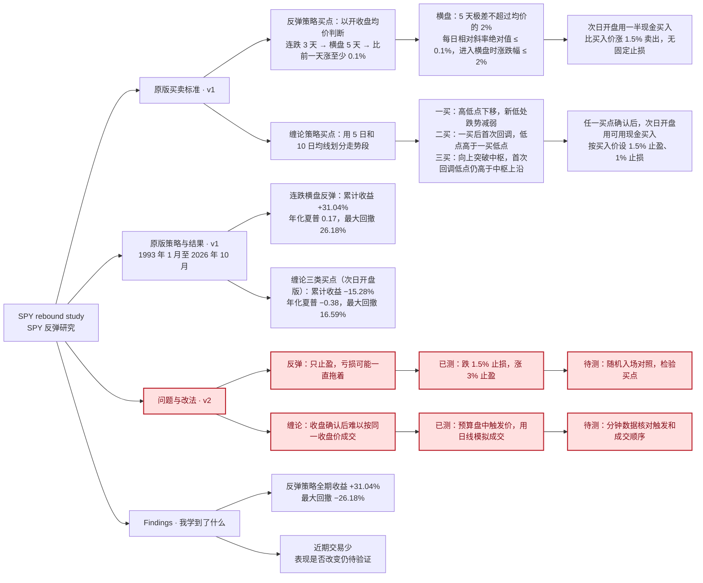
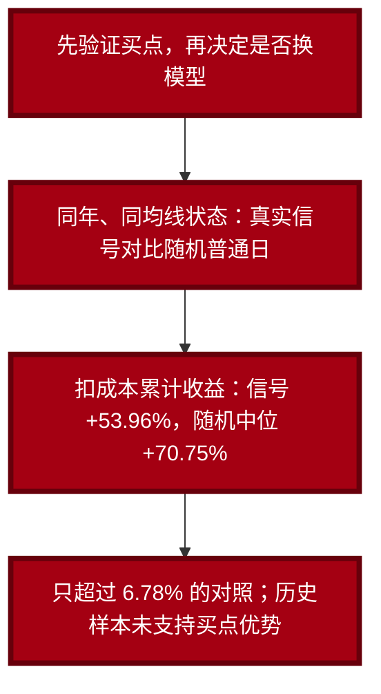
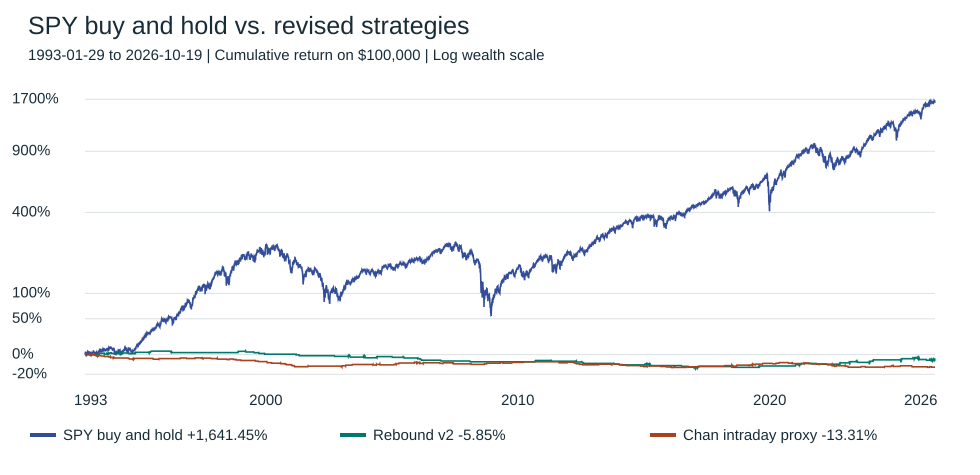
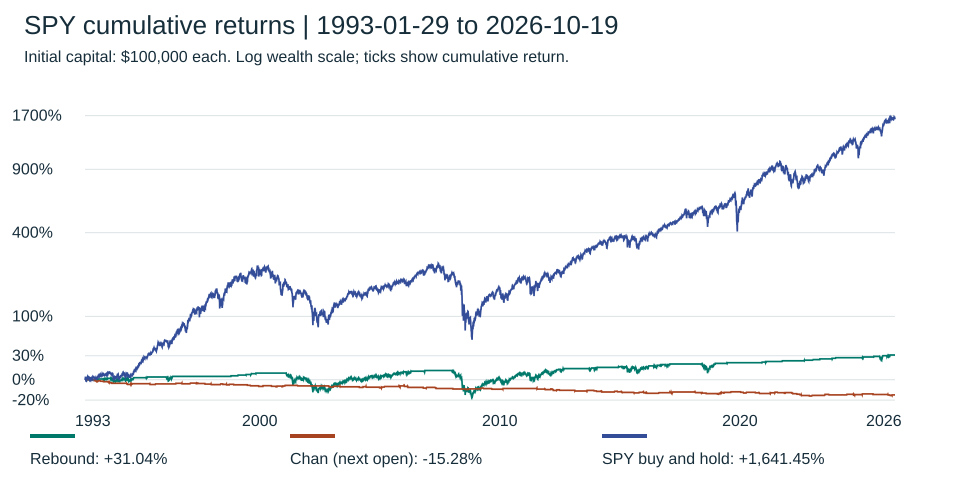

# SPY rebound strategy | SPY 反弹策略

[两套策略的问题与改法（HTML，下载后用浏览器打开）](./SPY策略复盘.html)

## 选择策略

| 策略目录 | 交易思路 | MATLAB 入口 |
|---|---|---|
| [反弹策略](./反弹策略/) | 连跌、横盘、反弹后买入 | `runSPY` |
| [缠论策略](./缠论策略/) | 用均线划分走势，识别三类买点 | `runChan` |

在 MATLAB 中进入对应的策略目录运行。共享数据和回测输出仍放在仓库根目录的 `data/` 和 `results/`。

## 这个文件有什么用？

这是给看项目的人读的说明书：策略怎么买卖、回测结果怎样、怎样自己运行。删掉后 MATLAB 仍能回测，但 GitHub 首页会少了这些说明和图表。

## 文件地图

## Project map | 项目思维导图

**CV summary (English).** Built a MATLAB backtest for two SPY trading strategies using daily prices from 1993 to 2026. Defined entry and exit rules, separated signal dates from execution dates, and compared returns, Sharpe ratios and drawdowns across periods.

**中文简历表述。** 用 MATLAB 对两套 SPY 交易策略进行回测，覆盖 1993 至 2026 年的日线数据。将买卖条件写成明确规则，区分信号日与成交日，并分时段比较收益率、夏普比率和最大回撤。

**研究约定：每次改策略都加对照，只记问题、方法、结果。**

## 缠论买点对照

- **问题**：均线上穿时，再挑缠论买点，能提高收益吗？
- **方法**：在同年、相同大盘趋势的上穿机会中随机抽取，保留各组机会数、仓位、卖点和费用，模拟 10,000 次。
- **结果**：缠论 −13.31%，随机中位 −12.23%；仅超过 41.51% 的对照，未达到 95% 门槛。

## 买点验证：与相似行情下的随机入场对照

**问题。** 在相似行情下，连跌、横盘、反弹的买点，比普通日子买入更赚钱吗？

**跑之前定的标准。** 比较扣除成本后的期末账户收益；只有超过至少 95% 的随机账户，才算本次比较支持这个买点。两组均从 10 万美元起步、次日开盘用半仓买入、涨 3% 卖、无固定止损；沿用同一手续费、滑点、跳空和持仓规则，期末持仓按收盘价估值，不另计分红。

**怎么配。** 1993-01-29 至 2026-10-19，有 70 个可在下一交易日执行的原始信号。每轮从非信号日无放回抽取 70 天，保证各年份、各 200 日均线状态（线上含相等、线下、预热期）的机会数与真实组相同。相似程度只按年份和趋势粗略匹配。两组持仓时都忽略新信号，所以实际成交笔数可以不同。随机种子 20261123，共 10,000 轮。

| 指标 | 真实买点 | 随机普通日 |
|---|---:|---:|
| 累计收益 | +53.96% | 中位 +70.75% |
| 实际入场笔数 | 30 | 中位 38 |
| 持仓交易日数（首尾日均计） | 4,498 | 中位 3,834 |

随机收益第 5 至第 95 百分位为 +52.13% 至 +95.45%。真实组只超过 678 / 10,000 组。**学习记录：策略历史赚钱，并不能说明买点选得好。这个买点没有通过事先定的门槛。** 同一段历史已经被多次研究；未见数据上的检验仍待完成。

*The signal beat only 6.78% of matched random-entry portfolios after costs. This historical test did not show an entry advantage.*

## 问题与改法 · 新规则回测

**策略一 · 反弹。** 最致命的问题是只设止盈，买错后可能长期持有。我把退出规则改成跌 1.5% 触发止损、涨 3% 止盈，保留原来的买点和半仓。全期最大回撤从 26.18% 降到 18.22%，累计收益却从 +31.04% 变为 −5.85%。我学到止损能改变亏损的分布，但买点有没有优势还要单独检验。**下一步（未做）**：用相同成本、仓位和退出规则，与随机入场比较，再用未参与选规则的数据验证。

*The new exits reduced drawdown, but the entry signal still needs testing.*

**策略二 · 缠论。** 最致命的问题是用最终收盘价确认信号，又假设能按这个价格买入。我改用盘前已经完成的走势段判定是否具备一、二、三买形态；开盘后用当天开盘价和实时价格的平均值更新均线，预先算出 5 日线上穿 10 日线的触发价。回测中当天最高价碰到触发价即模拟买入，跳空则用开盘价，另计滑点，即使收盘前信号消失也保留这笔交易。我学到：知道信号的时间决定了可以假设的成交价。**下一步（未做）**：逐分钟核对触发、止盈和止损先后，并测试成交延迟。

*The revised model enters at a price trigger; minute data is needed to check the fills.*

| 1993-01-29 至 2026-10-19 | 累计收益 | 最大回撤 |
|---|---:|---:|
| 买入持有 SPY | +1,641.45% | 56.47% |
| 反弹 v2（54 笔已平仓） | −5.85% | 18.22% |
| 缠论 v2（盘中触发模拟，127 笔已平仓） | −13.31% | 13.65% |

各以 10 万美元起步，两套策略均用半仓。缠论沿用 +1.5% 止盈、−1% 止损。日线无法还原盘中路径，模型按触发价加滑点估算买价；同日低点触及止损时保守假设入场后先止损，即使低点可能出现在买入前。跳空可能使亏损超过止损比例。未另计分红再投资。此处是同一历史样本上的规则比较。

新版复现入口：`python spy_v2_backtest.py SPY_1993_2026.csv chart.svg`。下方 MATLAB 说明、对比图和数字保留为原版记录。

## English

I built a daily backtest in MATLAB to answer a simple question: after SPY falls for several days and trades in a narrow range, does a small rebound give a useful entry signal?

I used the average of each day's open and close to measure the pattern. I looked for three daily declines, five days of sideways movement and then a rise of at least 0.1%. The strategy enters at the next open with half the available cash and sells when the price reaches 1.5% above the entry fill. It has no stop-loss. The backtest tracks cash, shares, fees and slippage, and values the account at each day's close.

I also compared it with an earlier version of a moving-average strategy based on three Chan-style buy points. That version uses the available cash to enter at the next open and sets a 1.5% profit target and a 1% stop. Position size and exit rules differ, so the comparison measures the two complete strategies.

**Problems I worked through**

- “Three down days, then sideways” was too vague to test. I defined the windows, the maximum price range and slope, and the minimum rebound before writing the entry rule.
- The signal needs the closing price. I separated the signal date from the next opening trade and checked that changing future prices did not change earlier signals. A later Chan implementation fills at the signal-day close. I used the saved next-open version for the comparison below.
- A profitable exit can hide a long period of losses while a position is open. I measured daily account value and drawdown, including open positions and idle cash. The rebound strategy gained 31.04% over the full period but fell 26.18% from its peak at one point.

## 中文

我用 MATLAB 回测了一个具体想法：SPY 连跌几天，随后价格走平，第一次小幅反弹是否值得买入？

我用每天开盘价和收盘价的平均值判断走势。连续下跌 3 天、横盘 5 天之后，如果一天上涨至少 0.1%，就在次日开盘用一半可用现金买入。价格比实际买入价上涨 1.5% 时卖出，没有止损。程序记录现金、股数、手续费和滑点，每天收盘计算账户净值。

我还比较了一个较早的缠论买点版本。它根据均线识别三类买点，次日开盘用可用现金建仓，设 1.5% 止盈和 1% 止损。两个版本的仓位和退出规则都不同，因此表里的差异反映的是整套策略的表现。

**遇到的问题和处理方法**

- “连跌后横盘”靠看图容易有不同解释。我把天数、横盘区间、斜率和反弹幅度写成明确条件，让同一组数据产生一致的信号。
- 当天收盘后才能确认信号。我分开记录信号日和成交日，并检查修改未来价格是否会影响已有信号。缠论代码后来改为信号日收盘成交，仍有时序问题；下图采用保存的次日开盘版本。
- 单看已卖出的交易，容易忽略等待止盈期间的亏损。我把未平仓头寸和闲置现金都计入每日净值。反弹策略全期累计赚了 31.04%，但账户从高点最多跌过 26.18%。

## Backtest results | 回测结果

### 全期累计收益对比 · Full-period cumulative returns

1993-01-29 至 2026-10-19，各以 10 万美元起步。反弹策略 **+31.04%**，缠论次日开盘版 **−15.28%**，首日开盘买入并持有 SPY **+1,641.45%**。基准计入买入手续费和滑点，期末按收盘价估值，未另计分红再投资。纵轴按账户净值的对数刻度绘制，标签显示累计收益率。

All three accounts start with $100,000. The benchmark buys SPY at the first open and holds through the final close. Entry costs are included; dividends are not separately reinvested.

Top row: rebound strategy. Bottom row: Chan buy points. Left: full history. Right: returns since January 2025, starting from zero. Vertical scales differ.  
上排为反弹策略，下排为缠论买点；左侧为全期，右侧为近期重新归零后的累计收益。各图纵轴刻度不同。

| Strategy / 策略 | Period / 时段 | Total return / 累计收益 | Annualized Sharpe / 年化夏普 | Max drawdown / 最大回撤 |
|---|---|---:|---:|---:|
| Rebound / 反弹 | Full / 全期 | +31.04% | 0.17 | −26.18% |
| Rebound / 反弹 | 1993–2024 | +27.30% | 0.16 | −26.18% |
| Rebound / 反弹 | 2025–2026 | +2.94% | 0.54 | −4.42% |
| Chan / 缠论 | Full / 全期 | −15.28% | −0.38 | −16.59% |
| Chan / 缠论 | 1993–2024 | −14.72% | −0.39 | −16.59% |
| Chan / 缠论 | 2025–2026 | −0.65% | −0.26 | −1.76% |

Dates: 1993-01-29 to 2026-10-19. The recent period begins 2025-01-02 and carries forward the account and signal history. Sharpe uses daily account returns including idle days, a zero risk-free rate and 252 trading days per year. Drawdown is measured from the running peak within each period. The short recent window gives limited evidence about changes in performance.

全期为 1993-01-29 至 2026-10-19，近期从 2025-01-02 开始，沿用此前的账户状态和信号历史。夏普按每日账户收益计算，包含空仓日，无风险利率取零，按每年 252 个交易日年化。最大回撤从各区间内的高点计算。近期样本较短，难以据此判断策略表现是否发生变化。

