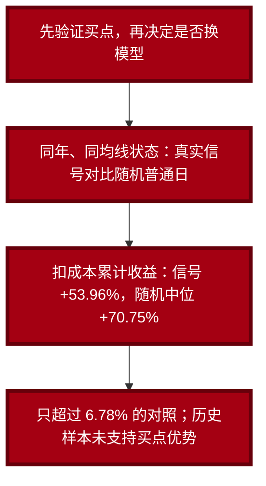

# 反弹策略

## 买点验证：与相似行情下的随机入场对照



**问题。** 在相似行情下，连跌、横盘、反弹的买点，比普通日子买入更赚钱吗？

**跑之前定的标准。** 比较扣除成本后的期末账户收益；只有超过至少 95% 的随机账户，才算本次比较支持这个买点。两组均从 10 万美元起步、次日开盘用半仓买入、涨 3% 卖、无固定止损；沿用同一手续费、滑点、跳空和持仓规则，期末持仓按收盘价估值，不另计分红。

**怎么配。** 1993-01-29 至 2026-10-19，有 70 个可在下一交易日执行的原始信号。每轮从非信号日无放回抽取 70 天，保证各年份、各 200 日均线状态（线上含相等、线下、预热期）的机会数与真实组相同。相似程度只按年份和趋势粗略匹配。两组持仓时都忽略新信号，所以实际成交笔数可以不同。随机种子 20261123，共 10,000 轮。

| 指标 | 真实买点 | 随机普通日 |
|---|---:|---:|
| 累计收益 | +53.96% | 中位 +70.75% |
| 实际入场笔数 | 30 | 中位 38 |
| 持仓交易日数（首尾日均计） | 4,498 | 中位 3,834 |

随机收益第 5 至第 95 百分位为 +52.13% 至 +95.45%。真实组只超过 678 / 10,000 组。**学习记录：策略历史赚钱，并不能说明买点选得好。这个买点没有通过事先定的门槛。** 同一段历史已经被多次研究；未见数据上的检验仍待完成。

*The signal beat only 6.78% of matched random-entry portfolios after costs. This historical test did not show an entry advantage.*


## 2026-11-23｜控制变量对照：1.5% 止损有什么影响？

下表记录已有回测的**累计收益率**（SPY 日线，1993-01-29 至 2026-10-19）。每一行固定止盈，横向比较有无止损；买入规则、半仓、费用和滑点相同。

| 止盈条件 | 不设止损 | 设 1.5% 止损 |
|---|---:|---:|
| 涨 1.5% 卖出 | +31.04%（原版） | −4.63% |
| **涨 3% 卖出** | **+53.96%** | **−5.85%** |

**初步结论：** 固定涨 3% 卖出，加上 1.5% 止损后，全期累计收益低了 **59.81 个百分点**。如果先看这段历史的累计收益，我会优先保留“涨 3% 卖、不设固定止损”作为候选。两组平仓次数也不同（30 笔与 54 笔），所以还不能把收益差全归因于“卖完马上反弹”，也不能据此判断不设止损的风险更小。

**下一步待查：** 把触发 1.5% 止损的交易逐笔列出来。卖出后，价格是继续跌，还是很快反弹？先看此后 1、5、20 个交易日相对卖出价的涨跌，再看是否回到原买入价、是否达到原定的 3% 止盈价，以及用了多久。尚未做这项逐笔检查。

*With the profit target fixed at 3%, the strategy earned more without the 1.5% stop in this sample. We still need to check what prices did after each stop.*


在本目录运行 `runSPY` 选择行情文件。回测结果和两套策略对比图见[项目首页](../README.md)。

## Implementation notes | 原项目使用与实现说明


这是单只股票的研究/回测项目，不连接券商、不下单。默认例子为人为构造的模拟价格，不能用来判断盈利能力。

## 使用

在 MATLAB 中打开此目录或项目，运行 `runDemo`。读取自己的数据：

```matlab
runDemo('D:\你的数据目录\stock.csv')
```

CSV 必须包含 `Date,Open,High,Close`，日期格式 YYYY-MM-DD，按日期升序且不能重复。每行一个真实交易日。不要填充周末。价格需为正值、无缺失值。

## 精确定义（参数在 strategyConfig.m）

1. 连跌：横盘之前的 3 个连续信号价格收益率均小于 0，需要 4 个信号价格。
2. 横盘：随后 5 个信号价格的极差/均价不超过 2%，线性拟合斜率/均价的绝对值不超过每日 0.1%。进入横盘的首日价格相对前日变化也不得超过 2%。
3. 反弹：横盘后的下一天，信号价格相对前日上涨至少 0.1%。它不是相对最低价上涨 0.1%。
4. 当天收盘才产生信号，下一交易日开盘按开盘价加 0.05% 滑点成交。使用当时现金的 50%，包含 0.05% 手续费，整股向下取整。
5. 买入后设止盈限价为实际买入价 × 1.015，触及即全部卖出。这是股价毛收益 1.5%，扣除手续费后净收益略低。日线 High 用于判断限价是否触及；假设立即挂单且足量成交，允许开盘买入当日止盈。已有仓位遇跳空高开时按开盘价扣滑点成交，但不低于限价。卖出后等待卖出日之后的新信号，不加仓。最后一天仅有买入信号不会成交。

**Strategy 1: Rebound Strategy.** Using the average of each day’s open and close, look for three declines, five quiet days, then a rise of at least 0.1%. Buy at the next open with half the available cash. Sell when the price reaches 1.5% above the entry price. There is no stop-loss.

这些定义是实现第一版所作的假设，不是用户已指定的唯一解释。标的固定为用户选择的 SPY ETF。止损、观察有效期和多股票资金分配尚未实现。

## 输出

results/daily.csv：每日信号、持仓、现金、资产和回撤。
results/trades.csv：信号日、成交日、成交价、股数、手续费。
results/summary.csv：总收益、最大回撤、买入持有收益、买入次数、期末持仓。
results/backtest.png：价格、资金曲线、回撤图。

买入持有基准在第一天开盘投入全部资金，并使用同样的费用及滑点模型。策略仅投入约一半资金，因此两者的风险暴露并不相同。现金利息默认零。

## 数据约定和限制

Open 和 Close 必须使用一致的价格口径。直接使用未复权价格会受拆股影响，且本程序未单独记分红、拆股、税费。若使用一致复权的 OHLC，可做简化研究，但对应股数/成交价并非真实历史成交记录。不能将复权 Close 与未复权 Open 混用。

默认每次成交按比例收费，不含最低佣金；假设次日开盘可按该价格加滑点成交，不处理停牌、成交量约束、涨跌停。严肃验证需补齐这些细节，用独立样本检验，不应只优化到历史最好结果。

## 验证

运行 `testStrategy`，检查信号触发、次日成交、费用预算、未来价格变化不影响已有信号、末日不成交和无信号情形。

项目代码可放 GitHub；默认忽略 results 和 data 下的 CSV。

## SPY 数据与运行

运行 `runSPY` 选择真实 SPY 日线 CSV；列为 Date,Open,High,Close，OHLC 必须保持同一复权口径。程序不会自动下载行情，也不能仅凭 CSV 文件名验证标的，请确保提供 SPY 数据。`runDemo` 仍是模拟数据，不能当作 SPY 历史收益。图上圆圈为信号、绿色上三角为买入、红色下三角为卖出。

## 从 GitHub 克隆后
在 MATLAB 中进入反弹策略目录，运行 initProject 重建并打开 MATLAB 项目，再运行 testStrategy、runDemo。MATLAB 自动项目元数据不上传；源代码可独立运行。


## 信号价格更新

所有买入条件统一使用 SignalPrice = (Open + Close) / 2；不是 Open + Close/2，也不是全天成交均价或 VWAP。SignalReturn 为此价格的日变化。日收盘后才能确定信号，仍于次日开盘成交。持仓日终估值仍用 Close，止盈仍按真实模拟买入价乘 1.015，用 High 判断是否触及。首图改画 SignalPrice；买卖点仍标实际成交价，可能不在曲线上。
